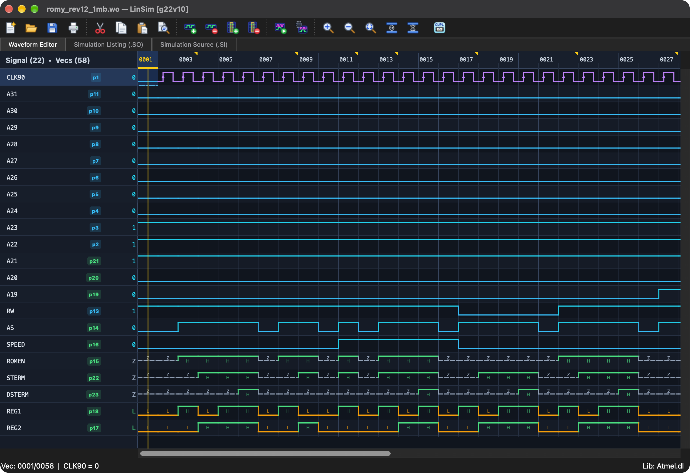

# LinCUPL

LinCUPL is a CUPL toolchain for programmable logic on Linux, macOS and
Windows. It compiles CUPL designs (`.pld`) into JEDEC fuse maps for PAL, GAL
and other SPLDs, the ATF750 and ATF2500, and the ATF1502/1504/1508 CPLDs. It also
simulates them against test vectors (`.si`). It comes with an IDE and a
waveform editor.

## Screenshots

`lincupl`, the IDE, editing the source of ROMY (a Kickstart ROM mapper for the
Amiga 3000/4000, built for a GAL22V10):


`linsim` showing the waveform that `csim` produced for ROMY's test vectors:



## Tools

| Program | Purpose |
|---|---|
| `cupl` | The compiler: `.pld` → `.jed` (and `.abs`, `.doc`, `.lst`, `.pla`, …) |
| `csim` | The simulator: runs the vectors of a `.si` file against the compiled design, or against the fuse map of a `.jed` file |
| `jedinspect` | Inspects JEDEC fuse maps, prints fuse ranges and compares fuse states; supports JSON output |
| `jedcompare` | Checks combinational or sequential JEDEC pin equivalence and reports counterexamples |
| `fit1502`, `fit1504`, `fit1508` | Fitters for ATF150x CPLDs, accepting truth tables, EDIF and Boolean equations |
| `cbld` | Lists the devices of a device library (`.dl`) and builds libraries |
| `backpin` | Writes the pins a fitter chose back into the `.pld` file |
| `cfitr` | Helper that runs an external fitter and records its exit status |
| `lincupl` | IDE: editor, compile and simulate, device browser, help (Qt 6) |
| `linsim` | Waveform viewer and test-vector editor for `.si`/`.wo` files (Qt 6) |

## Building

For native Windows binaries and MSVC build instructions, see
[Windows](doc/windows.md). The commands below are for Linux and macOS.

You need:

- CMake 3.16 or newer
- a C11 compiler
- Python 3, to compile the device library

For the GUI programs you also need a C++17 compiler and Qt 6 (Widgets and
PrintSupport; Qt Help is optional).

```sh
cmake -B build
cmake --build build -j
cmake --install build --prefix /usr/local
```

Without Qt, or with `-DLINCUPL_BUILD_GUI=OFF`, only the command-line tools
are built.

To install the dependencies:

```sh
brew install cmake qt python3                                  # macOS
sudo apt install build-essential cmake qt6-base-dev python3    # Debian, Ubuntu
sudo dnf install gcc gcc-c++ cmake qt6-qtbase-devel python3    # Fedora
```

### Device libraries

The build compiles the checked-in descriptions into `lincupl.dl`, the default
library used by the compiler, simulator and device tools. Reusable hardware
models supply 51 GAL16V8, GAL20V8, ATF750C, GAL22V10 and ATF2500C interfaces;
catalog descriptions supply the other 609 mnemonics from `Atmel.dl` and
`cupl.dl`. `cmake --install` installs it under `<prefix>/share/lincupl`; no library download is required.

The complete catalog sources remain in `devices/Atmel/` and `devices/cupl/`,
with hardware models in `devices/families/`. `devices/manifest.json` selects
the default replacements. See the [language reference](doc/device-language.md)
and [implementation notes](doc/device-implementation.md) for compilation,
validation and deliberate differences.

## Usage

For Verilog synthesis with Yosys and direct ATF150x fitting, see
[EDIF input](doc/edif.md).

For fuse-map inspection and equivalence checking, see
[JEDEC tools](doc/jed-tools.md). `jedcompare` currently supports combinational
GAL16V8, GAL20V8, GAL22V10 and ATF1502/1504/1508 designs without physical
output feedback. `--sequential` also covers ATF750 and ATF2500, includes
physical output feedback, and supports explicit or symbolic register
preloads. It explores all reachable state pairs, with explicit resource
limits and counterexample traces.

Compile a design to a JEDEC file (`-j`), an absolute file for the simulator
(`-a`), a documentation file (`-x`) and a listing (`-l`), then simulate it:

```sh
cupl -jaxl counter.pld
csim -lw counter          # reads counter.si, writes counter.so and counter.wo
```

The device is named in the design (`Device g22v10;`) or on the command line
(`cupl -jxa g22v10 counter.pld`). Run `cupl` or `csim` without arguments
for the list of flags. The most common ones:

| Flag | Meaning |
|---|---|
| `-j` / `-a` / `-x` / `-l` | write `.jed` / `.abs` / `.doc` / `.lst` |
| `-m0` … `-m4` | minimization: none, quick (default), Quine-McCluskey, Presto, Espresso |
| `-kb`, `-kd` | choose polarity per output / apply DeMorgan to all outputs |
| `-s`, `-w` | simulate after compiling; also write the waveform file `.wo` |
| `-u lib.dl` | use this device library |
| `csim -j` | append the test vectors to the `.jed` file |
| `csim -f` | simulate the fuse map of the `.jed` file instead of the compiled design |

**Simulating a JEDEC file.** `csim -f` takes the design from the fuse map
in `name.jed` and needs no `.abs` file. It supports GAL16V8, GAL20V8,
GAL22V10, ATF750, ATF2500 and ATF1502/1504/1508 maps, including files read
back from a part or written by another compiler.

```sh
csim -lf u12              # reads u12.jed and u12.si, writes u12.so and u12.wo
csim -lf g20v8lcc u12     # the same as this device (for a file that does not say it is a PLCC part)
```

- The device is the one named on the command line. Without one it is the
  device of `u12.pld`, if that file is there and the fuse map fits it; else
  the device the JEDEC file names (`cupl` writes it into the file), on the
  same condition; else it follows from the number of fuses: 2194 is a
  GAL16V8, 2706 a GAL20V8, 5892 or 5828 (no signature) a GAL22V10, in the
  PLCC package if the file says it has 28 pins (QP28). A file that says
  neither is taken for the DIP package: name the device to get the pin
  numbers of a PLCC part. The mode of a GAL16V8 or GAL20V8 (simple,
  complex, registered) is read from its SYN and AC0 fuses; a mode can also
  be named (`g16v8ms`, `g16v8ma`, `g16v8s`).
- ATF750 maps have 14394, 14435 or 14504 fuses; ATF2500 maps have
  71648, 71745 or 71816. Their QP28 or QP44 field selects the PLCC
  package. C-revision feedback and pin-keeper option bits select the
  corresponding library variant. The decoder handles both registers
  per macrocell, D/T selection, shared product terms, output polarity
  and enable, product and global clocks, asynchronous reset and shared
  synchronous preset. Pin keepers are identified, but their electrical
  behavior is not simulated.
- ATF1502AS, ATF1504AS and ATF1508AS maps have 16808, 34192 and 74136 fuses.
  Their package comes from the device name, such as `f1504plcc44`, or QP
  when the pin count identifies exactly one package. Ambiguous packages
  require an explicit device. Routing, foldback, cascades, D/T registers,
  latches, clocks, clear/preset, enables, open-drain outputs and logical
  bus-keeper state are decoded using the fitter's package/wiring tables.
  Simulation observes physical package pins; internal macrocells are
  evaluated but are not exposed as numbered `PINNODE` signals. Power-down
  holds registers, outputs and output enables. A `P` vector directly loads
  bonded macrocell registers with physical storage values `0`, `1` or `X`;
  omitted registers retain their state. Timing and JTAG programming are not
  simulated. ATF1502BE, ATF1504BE and ATF1508BE maps use their distinct
  16814/34198/74146-fuse layouts, including per-pin termination and native
  ATF1504BE/1508BE toggle storage.
- A fuse map has no names. The pins are `P1`, `P2`, … in the `ORDER`
  statement, and their test values are levels at the pins. If `u12.pld` is
  there, the pins also have the names of its `PIN` declarations (and its
  `FIELD`s), with their polarity as for a compiled design. Declarations
  of the forms `PIN 2 = !cs;` and `PIN [3..6] = [a3..0];` are read, from
  the text as `cupl`'s preprocessor leaves it: with `$INCLUDE` files, the
  names that `$DEFINE` replaces, and what `$IFDEF` selects. Declarations
  made by `$REPEAT` or `$MACRO` are not found.
- ATF buried nodes and register aliases use their library numbers, such
  as `P34` on `v750c` or `P41` on `v2500c`. An adjacent source file can
  name these with `PINNODE`. Register feedback is independent of the
  physical I/O level, including when a disabled output is driven externally.
  A map using an input column absent from its library entry is rejected.
- csim prints the device and which pins the fuses make inputs,
  combinatorial outputs and registered outputs. A macrocell without
  product terms whose output is never enabled is an input. Product terms
  of a macrocell that the fuses make an input have no effect in the
  device, and note `[0039sa]` names the pin. `cupl` writes such a map for
  a design that is forced into the simple mode (`g16v8s`) and reads an
  output back: the compiled design simulates as written, the fuse map as
  the device behaves.
- The output enable pin of the registered modes (pin 11 of the GAL16V8,
  13 of the GAL20V8) enables the outputs unless a vector drives it. The
  reset and preset terms of a GAL22V10 act on all its registers, as in
  the device.
- `-l` and `-w` work as usual; `-j` appends the vectors to `u12.jed`.
- The file may come from other tools: files without STX/ETX, without a QF
  or F field, with lower-case fields or other line ends are read. A file
  with a wrong fuse checksum, or one that ends without ETX and without a
  fuse checksum, is refused.

**ATF150x CPLDs.** For `f1502…`, `f1504…` and `f1508…` devices, `cupl`
writes a `.tt2` file and runs the fitter. The fitter writes the `.jed`,
`.fit` (report), `.pin` and `.io` files. A fitter can also be run on its
own:

```sh
fit1508 -i design.tt2 -CUPL -dev P1508C84 -str JTAG OFF
```

For combinational designs, [Boolean equation input](doc/eqn.md) accepts
`INORDER`, `OUTORDER` and equations such as `q = a * b + c`:

```sh
fit1504 -i design.eqn -ifmt EQN -device PLCC44 -tech ATF1504AS
```

The fitters include their default register and buffer mapping primitives.
An external `atmel.std` gate library is optional; an available library is
used in preference to the built-in primitives.

The fitters run in a legacy mode by default. With
`LINCUPL_FIT150X_MODE=extended` set in the environment they run in an
extended mode that knows more options and devices and writes a different
report. Let the fitter place pins with `Pin = name;` (no number); then
write its choice back into the design:

```sh
backpin f1508ispplcc84 design.pld
```

**Device libraries.** To list the devices, show one device in detail, or
list the extensions a device takes:

```sh
cbld -t                      # devices of the default library
cbld -l g16v8                # architecture of one device
cbld -e g22v10               # valid extensions (.d, .oe, .ar, …)
```

The tools look for the device library in this order:

1. `-u file.dl`
2. the `LIBCUPL` environment variable (a `.dl` file)
3. the directory named by `LINCUPL_SHARE`
4. `../share/lincupl` next to the program
5. the current directory and `share/lincupl` below it
6. the install prefix's `share/lincupl`, then `/usr/local/share/lincupl` and
   `/usr/share/lincupl`

In a directory, the tools take `lincupl.dl` first, then `Atmel.dl`, then
`cupl.dl`.

**GUI.** Open designs with `lincupl [file.pld …]` and test vectors or
waveforms with `linsim [file.si | file.wo …]`. The help pages (Help >
Contents) describe the CUPL language, the simulator, the devices and every
option. Their sources are in `doc/help`.

## Development

```text
src/cupl/      compiler: preprocessor, parser, expansion, minimizer, fuse map and output files
src/sim/       simulator
tests/         csim_jed.py: `csim -f` against the simulation of the compiled design (run by `ctest`)
src/fit150x/   ATF1502/1504/1508 fitters
src/tools/     cbld, backpin, cfitr
src/shared/    code used by several programs (library files, paths, checksums)
src/gui/       lincupl, linsim and their shared code
doc/help/      help pages and the example designs they show
third_party/espresso/  Berkeley Espresso 2.5.1 (minimization level -m4)
```

## Trademarks

LinCUPL is an independent project. It is not affiliated with, endorsed by, or
sponsored by Microchip Technology Inc., Atmel Corporation or Logical Devices,
Inc. CUPL, WinCUPL, ATF and Atmel are trademarks or registered trademarks of
their respective owners. They are used here only to say which file formats and
devices LinCUPL works with.

## License

BSD 2-Clause; see [LICENSE](LICENSE). Berkeley Espresso in
`third_party/espresso` has its own license
(`third_party/espresso/COPYRIGHT`). The device libraries and example designs
from the download are not covered by this license. They stay under their
owner's terms.
