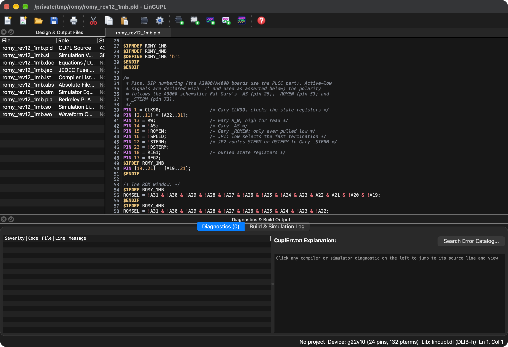

# LinCUPL

LinCUPL is a CUPL toolchain for programmable logic on Linux and macOS. It
compiles CUPL designs (`.pld`) into JEDEC fuse maps for PAL, GAL and other
SPLDs, the ATF750 and ATF2500, and the ATF1502/1504/1508 CPLDs. It also
simulates them against test vectors (`.si`). It comes with an IDE and a
waveform editor.

## Screenshots

`lincupl`, the IDE, editing the source of ROMY (a Kickstart ROM mapper for the
Amiga 3000/4000, built for a GAL22V10):



`linsim` showing the waveform that `csim` produced for ROMY's test vectors:


## Tools

| Program | Purpose |
|---|---|
| `cupl` | The compiler: `.pld` → `.jed` (and `.abs`, `.doc`, `.lst`, `.pla`, …) |
| `csim` | The simulator: runs the vectors of a `.si` file against the compiled design |
| `fit1502`, `fit1504`, `fit1508` | Fitters for the ATF150x CPLDs; `cupl` starts them itself |
| `cbld` | Lists the devices of a device library (`.dl`) and builds libraries |
| `backpin` | Writes the pins a fitter chose back into the `.pld` file |
| `cfitr` | Helper that runs an external fitter and records its exit status |
| `lincupl` | IDE: editor, compile and simulate, device browser, help (Qt 6) |
| `linsim` | Waveform viewer and test-vector editor for `.si`/`.wo` files (Qt 6) |

## Building

You need:

- CMake 3.16 or newer
- a C11 compiler
- Python 3, for the data download

For the GUI programs you also need a C++17 compiler and Qt 6 (Widgets and
PrintSupport; Qt Help is optional).

```sh
./wincupl-extract-data          # download the device libraries (see below)
cmake -B build
cmake --build build -j
cmake --install build --prefix /usr/local
```

Without Qt, or with `-DLINCUPL_BUILD_GUI=OFF`, only the command-line tools
are built.

To install the dependencies:

```sh
brew install cmake qt python3                                  # macOS
sudo apt install build-essential cmake qt6-base-dev python3    # Debian, Ubuntu
sudo dnf install gcc gcc-c++ cmake qt6-qtbase-devel python3    # Fedora
```

### Device libraries

The device descriptions (`Atmel.dl`, `cupl.dl`), macros and example designs
are not part of this repository. `wincupl-extract-data` downloads Microchip's
WinCUPL installer and extracts these files into `share/lincupl/`. It uses
only the Python standard library, and it checks the archive's SHA-256.

```sh
./wincupl-extract-data                         # download from microchip.com
./wincupl-extract-data --file awincupl.exe.zip # or use a copy you already have
```

The build works without these files. The tools then have no devices to
compile for. When the files are present, the
build also makes `lincupl.dl`, a library with the devices of both
`Atmel.dl` and `cupl.dl`. `cmake --install` installs it with the other data
under `<prefix>/share/lincupl`.

## Usage

Compile a design to a JEDEC file (`-j`), an absolute file for the simulator
(`-a`), a documentation file (`-x`) and a listing (`-l`), then simulate it:

```sh
cupl -jaxl counter.pld
csim -lw counter          # reads counter.si, writes counter.so and counter.wo
```

The device is named in the design (`Device g22v10;`) or on the command line
(`cupl -jxa g22v10 counter.pld`). Run `cupl` or `csim` without arguments
for the list of flags. The most common ones:

| Flag | Meaning |
|---|---|
| `-j` / `-a` / `-x` / `-l` | write `.jed` / `.abs` / `.doc` / `.lst` |
| `-m0` … `-m4` | minimization: none, quick (default), Quine-McCluskey, Presto, Espresso |
| `-kb`, `-kd` | choose polarity per output / apply DeMorgan to all outputs |
| `-s`, `-w` | simulate after compiling; also write the waveform file `.wo` |
| `-u lib.dl` | use this device library |
| `csim -j` | append the test vectors to the `.jed` file |

**ATF150x CPLDs.** For `f1502…`, `f1504…` and `f1508…` devices, `cupl`
writes a `.tt2` file and runs the fitter. The fitter writes the `.jed`,
`.fit` (report), `.pin` and `.io` files. A fitter can also be run on its
own:

```sh
fit1508 -i design.tt2 -CUPL -dev P1508C84 -str JTAG OFF
```

The fitters run in a legacy mode by default. With
`LINCUPL_FIT150X_MODE=extended` set in the environment they run in an
extended mode that knows more options and devices and writes a different
report. Let the fitter place pins with `Pin = name;` (no number); then
write its choice back into the design:

```sh
backpin f1508ispplcc84 design.pld
```

**Device libraries.** To list the devices, show one device in detail, or
list the extensions a device takes:

```sh
cbld -t                      # devices of the default library
cbld -l g16v8                # architecture of one device
cbld -e g22v10               # valid extensions (.d, .oe, .ar, …)
```

The tools look for the device library in this order:

1. `-u file.dl`
2. the `LIBCUPL` environment variable (a `.dl` file)
3. the directory named by `LINCUPL_SHARE`
4. `../share/lincupl` next to the program
5. the current directory and `share/lincupl` below it
6. the install prefix's `share/lincupl`, then `/usr/local/share/lincupl` and
   `/usr/share/lincupl`

In a directory, the tools take `lincupl.dl` first, then `Atmel.dl`, then
`cupl.dl`.

**GUI.** Open designs with `lincupl [file.pld …]` and test vectors or
waveforms with `linsim [file.si | file.wo …]`. The help pages (Help >
Contents) describe the CUPL language, the simulator, the devices and every
option. Their sources are in `doc/help`.

## Development

```text
src/cupl/      compiler: preprocessor, parser, expansion, minimizer, fuse map and output files
src/sim/       simulator
src/fit150x/   ATF1502/1504/1508 fitters
src/tools/     cbld, backpin, cfitr
src/shared/    code used by several programs (library files, paths, checksums)
src/gui/       lincupl, linsim and their shared code
doc/help/      help pages and the example designs they show
third_party/espresso/  Berkeley Espresso 2.5.1 (minimization level -m4)
```

## Trademarks

LinCUPL is an independent project. It is not affiliated with, endorsed by, or
sponsored by Microchip Technology Inc., Atmel Corporation or Logical Devices,
Inc. CUPL, WinCUPL, ATF and Atmel are trademarks or registered trademarks of
their respective owners. They are used here only to say which file formats and
devices LinCUPL works with.

## License

BSD 2-Clause; see [LICENSE](LICENSE). Berkeley Espresso in
`third_party/espresso` has its own license
(`third_party/espresso/COPYRIGHT`). The device libraries and example designs
from the download are not covered by this license. They stay under their
owner's terms.
